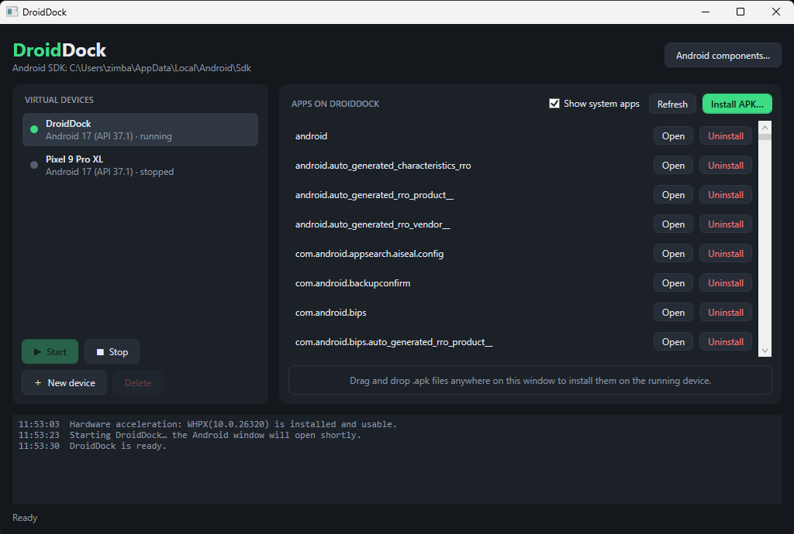

# DroidDock

Run Android apps on a Windows PC — without installing Android Studio.

DroidDock is a small, open-source Windows app that wraps Google's official
[Android Emulator](https://developer.android.com/studio/run/emulator). It downloads the
emulator for you, creates virtual devices in one dialog, and lets you install apps by
dragging `.apk` files onto its window.



## Features

- **One-click setup** – downloads the Android Emulator, `adb` and an Android system image
  straight from Google, verifying every file's checksum. No Java and no Android Studio needed.
- **Uses what you already have** – if an Android SDK is already installed (for example by
  Android Studio), DroidDock finds it and shows its existing virtual devices.
- **Virtual devices** – create phone, tablet or desktop-sized devices; start, stop and delete them.
- **Apps** – list installed apps, open or uninstall them, and install `.apk` files by
  drag-and-drop or with the *Install APK…* button.
- **Google Play** – pick a "Google Play" system image to get the Play Store inside the device.

## Requirements

- Windows 10 or 11, 64-bit
- A CPU with virtualization enabled in the BIOS/UEFI (Intel VT-x or AMD-V)
- **Windows Hypervisor Platform** turned on
  (*Turn Windows features on or off* → tick *Windows Hypervisor Platform* → restart).
  DroidDock reports whether acceleration is usable in its log pane on start-up.
- About 8 GB of free disk space for the emulator plus one Android image
- [.NET 9 Desktop Runtime](https://dotnet.microsoft.com/download/dotnet/9.0), unless you
  build a self-contained copy (see below)

## Build and run

You need the [.NET 9 SDK](https://dotnet.microsoft.com/download/dotnet/9.0).

```
git clone https://github.com/zimba7768/DroidDock.git
cd DroidDock
dotnet run --project src/DroidDock
```

Run the tests:

```
dotnet test
```

Build a single self-contained `DroidDock.exe` that runs on PCs without .NET installed:

```
dotnet publish src/DroidDock -c Release -r win-x64 --self-contained -p:PublishSingleFile=true -o publish
```

## Using it

1. Start DroidDock. If no Android Emulator is found, the **Android components** dialog opens:
   choose a system image, read and accept Google's license, and click *Download and install*.
2. Click **New device**, pick an Android version and screen size, and click *Create*.
3. Select the device and click **Start**. The Android window opens; the first boot takes a minute or two.
4. Drag `.apk` files onto the DroidDock window to install them, then click **Open** next to an app.

## How it works

| Part | What it does |
| --- | --- |
| `Services/SdkPaths.cs` | Finds an Android SDK (`ANDROID_SDK_ROOT`, `ANDROID_HOME`, Android Studio's default folder, or DroidDock's own under `%LOCALAPPDATA%\DroidDock\sdk`). |
| `Services/SdkRepository.cs` | Reads Google's public SDK repository index and downloads, verifies and unpacks packages. |
| `Services/AvdService.cs` | Creates and lists virtual devices by writing their `config.ini` files directly. |
| `Services/EmulatorService.cs` | Launches `emulator.exe` and checks hardware acceleration. |
| `Services/AdbService.cs` | Talks to running devices through `adb` (install, list, open, uninstall, stop). |

Virtual devices live in the standard `%USERPROFILE%\.android\avd` folder, so they also show
up in Android Studio, and vice versa.

## Known limitations

- Only single `.apk` files can be installed; `.xapk` / `.apks` bundles are not supported yet.
- Apps are listed by package name (for example `org.mozilla.firefox`), not by their display name.
- Apps built only for ARM processors may not run on the x86-64 Android images.
- Windows on ARM is untested.

## Contributing

Issues and pull requests are welcome. Please run `dotnet test` before opening a pull request.

## License and credits

DroidDock is released under the [MIT License](LICENSE).

DroidDock does not include or redistribute the Android Emulator, system images or any other
Google software. Those are downloaded by you from Google and are covered by the
[Android SDK License Agreement](https://developer.android.com/studio/terms), which DroidDock
shows before downloading. Android and Google Play are trademarks of Google LLC. DroidDock is
not affiliated with or endorsed by Google.
